# BitKiln

Pixel art plugin for Godot 4.6+: modify, bake and create pixel sprites inside the editor.
Effects stack non-destructively on a source image and bake to plain PNGs, so exported games
don't need the plugin, and the original art is never touched.

- **Recipes** instead of edited copies: source images, a stack of ops and the files to write.
  One recipe can serve a whole set of sprites, and write several versions of each. Change a
  source in Aseprite and the recipe bakes again by itself.
- **Pixel-art ops**: outlines (including selective outlines), drop and long shadows, glows in
  crisp rings, blurs snapped to a few alpha levels, palette swaps that make one variant per
  palette, quantizing with dithering, color reduction, gradient maps, and masks to limit any op
  to part of the sprite.
- **Scalers and rotation** that add no new colors: Scale2x / Scale3x / Scale4x (EPX), MMPX, and
  RotSprite rotation, including 8- or 16-direction sets.
- **Lighting**: normal maps for 2D lights (snapped to a few directions so light falls in clean
  bands, ready-made `CanvasTexture`s) and automatic banded, hue-shifted shading.
- **Animation**: turn a still sprite into an animated sheet with juice effects (squash and
  stretch, hops, shakes, wobbles, spins, waves, flashes, fades, dissolves, afterimages) and
  ready-made presets; play it in the dock and export GIFs.
- **Particles**: fire, smoke, sparks, explosions, magic, weather and more, simulated and drawn
  as pixel art, deterministic and seamlessly looping, with presets.
- **Sprite sheets**: frame-grid guessing, repacking, and `SpriteFrames` for AnimatedSprite2D.
- **Generators** for making art from nothing: pixel-perfect shapes, animated FX sheets
  (sparkles, impacts, smoke, slashes, orbs, shockwaves), seeded random sprites, tileable noise
  textures and hue-shifted palette ramps.
- **Tiles**: a 47-tile blob set built from five hand-drawn tiles, written as a `TileSet` with the
  terrain already set up.
- **Bake Material**: freeze any CanvasItem shader (a hit flash, a dissolve, your own) into the PNG.
- **Editor tools**: a dock with a live preview (side by side, lit by a light that follows the
  mouse), bake status for every recipe, pixel-art import checks, and a Lospec palette importer.

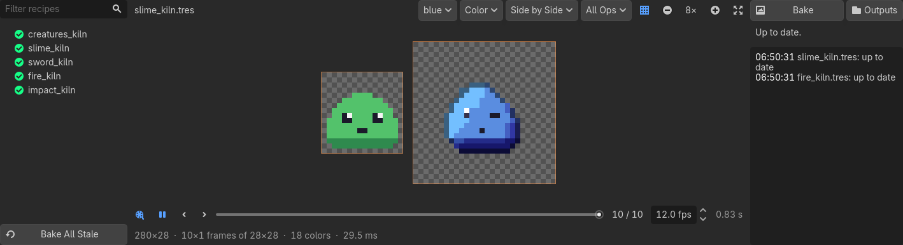

| Animate: Jelly | Particles: Fire | FX sheet: Impact | Animate: Death Dissolve |
|---|---|---|---|
| 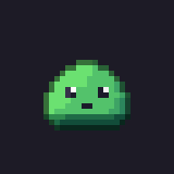 | 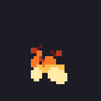 | 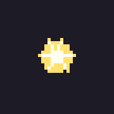 | 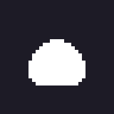 |

Every image on this page was baked by BitKiln itself, from a flat 16×16 slime, a sword, or a blank
canvas. Each section shows the ops behind its pictures.

## Contents

- [Requirements](#requirements)
- [Installation](#installation)
- [Quick start](#quick-start)
- [Recipes](#recipes)
  - [Frames](#frames)
  - [Outputs](#outputs)
  - [Where baked files go](#where-baked-files-go)
- [Ops](#ops)
  - [Masks](#masks)
  - [Palettes and variants](#palettes-and-variants)
  - [Scalers](#scalers)
  - [Rotation](#rotation)
  - [Normal maps](#normal-maps)
  - [Shading](#shading)
  - [Glow and blur](#glow-and-blur)
  - [Sprite sheets](#sprite-sheets)
  - [Overlays](#overlays)
  - [Baking a material](#baking-a-material)
- [Animation](#animation)
- [Frame counts and speed](#frame-counts-and-speed)
- [Particles](#particles)
- [Generators](#generators)
  - [Shapes](#shapes)
  - [FX sheets](#fx-sheets)
  - [Random sprites](#random-sprites)
  - [Noise and ramps](#noise-and-ramps)
- [Autotiles](#autotiles)
- [Editor tools](#editor-tools)
  - [Baking and auto bake](#baking-and-auto-bake)
  - [Import checks](#import-checks)
- [Using recipes from code](#using-recipes-from-code)
  - [Writing your own op](#writing-your-own-op)
- [Class reference](#class-reference)
- [Troubleshooting](#troubleshooting)
- [Limitations](#limitations)
- [License](#license)

## Requirements

- Godot **4.6** or later (it uses the editor dock API added in 4.6).
- Any renderer. Bake Material renders through the GPU and has been tested with Compatibility;
  every other op runs on the CPU.
- BitKiln is an editor tool: baked outputs are plain PNGs and `.tres` resources, so exported games
  don't need it. Running recipes at runtime ([Using recipes from code](#using-recipes-from-code))
  is the exception.

## Installation

1. Install **BitKiln** from the **AssetLib** tab at the top of the editor, which puts it in
   `addons/bitkiln`. Or clone this repository into your project's `addons` folder as `bitkiln`:
   ```bash
   git clone https://github.com/Reshiramoo/BitKiln.git addons/bitkiln
   ```
   (or add it as a submodule: `git submodule add https://github.com/Reshiramoo/BitKiln.git addons/bitkiln`).
   The folder must be named `bitkiln`.
2. **Project → Project Settings → Plugins** → enable **BitKiln**. A **BitKiln** tab appears in
   the bottom panel.

## Quick start

1. Right-click a sprite in the FileSystem dock → **New BitKiln Recipe**. This saves
   `hero_kiln.tres` next to `hero.png` and opens it in the Inspector and the BitKiln dock.
2. In the Inspector, add ops to **Ops**: for example a **BitKilnPad** (room for the outline), then
   a **BitKilnOutline**. The dock's preview follows every change.
3. Click **Bake** in the dock. The recipe writes `baked/<folder>/hero/hero.png` (see
   [Where baked files go](#where-baked-files-go)); **Outputs** next to Bake opens it.
4. Use the baked file in your game like any other texture. When you change `hero.png`, the
   recipe bakes again by itself.

Select several images and choose **New Shared BitKiln Recipe** for one recipe that bakes them all
the same way.

To make art from nothing, right-click a folder → **New BitKiln Canvas** instead: a recipe without
a source, starting from a blank canvas for [generators](#generators) to draw on.

## Recipes

A [BitKilnRecipe](docs/classes/BitKilnRecipe.md) is a resource with:

| Property | Meaning |
|---|---|
| `sources` | The images to start from. Each goes through the same ops and gets its own files. BitKiln reads their files directly, so import settings (compression, mipmaps) don't change the pixels. Leave it empty to start from a blank canvas. |
| `frames` | Columns and rows of frames, for sprite sheets (see [Frames](#frames)). |
| `auto_frames` | Guess each source's frame grid instead, for sources with different layouts. |
| `canvas_size` | Without a source: the size of one blank frame. |
| `ops` | [BitKilnOp](docs/classes/BitKilnOp.md)s, applied top to bottom. Each has an **Enabled** switch, to compare with and without it. |
| `outputs` | [BitKilnOutput](docs/classes/BitKilnOutput.md)s: the files to write when baked. |
| `auto_bake` | Bake again whenever the source, or a palette an op uses, is reimported. |

Recipes are ordinary `.tres` files: keep them next to the art, commit them, duplicate them as
starting points for similar sprites. A recipe's source can be another recipe's output, to chain
them. Recipes from before `sources` existed (with a single `source`) load into it.

### Frames

Set `frames` to the sheet's grid (8×1 for an eight-frame strip), or click **Guess Frame Grid**
next to it in the Inspector: BitKiln picks the most frames whose edges cut no sprite. New
recipes start with that guess. Every op then works on each
frame as if it were its own image: outlines, shadows and normal maps stop at frame edges instead
of reaching into the next frame, scalers scale frames one by one, and padding or trimming
changes every frame by the same amount so the grid stays regular.

### Outputs

| Kind | Writes |
|---|---|
| **Color** | The result, as a PNG. |
| **Normal** | The normal map from a [BitKilnNormalMap](docs/classes/BitKilnNormalMap.md), as a PNG. |
| **Canvas Texture** | A `CanvasTexture` `.tres` pairing the recipe's Color and Normal outputs, with the nearest filter: drop it on a Sprite2D and it reacts to 2D lights. Needs a Color and a Normal output in the same recipe. |
| **Palette** | Every color of the result, darkest first, as a one-row PNG: a palette for Palette Swap, Quantize or palette shaders. |
| **Sprite Frames** | A `SpriteFrames` `.tres` for an AnimatedSprite2D, cut from the Color output: one animation, or one per row (named, looping or not), leaving out empty cells. Plays at the speed of the recipe's animation unless **Fps** is set (see [Frame counts and speed](#frame-counts-and-speed)). See [Sprite sheets](#sprite-sheets). |
| **Tile Set** | A `TileSet` `.tres` with the Color output as an atlas, one tile per non-empty frame; after an Autotile op, with a terrain set up for painting. See [Autotiles](#autotiles). |
| **GIF** | The frames as an animated GIF (at the animation's speed or its own **Fps**, looping, empty frames left out, each pixel scaled up by **Gif Scale**), for sharing outside the game. |

An output's `path` can use `{out}` (where the project's [layout](#where-baked-files-go) puts
this source's files, without extension), `{dir}` (the source's folder), `{name}` (the source's
file name without extension), `{recipe}` (the recipe's file name) and `{variant}` (an underscore
and the variant's name, or nothing). Without a source, `{dir}` and `{name}` come from the recipe
itself, minus a `_kiln` suffix (`spark_kiln.tres` bakes `spark.png`). The default is
`{out}{variant}.png`. A recipe never
overwrites its own source, and files whose bytes didn't change aren't rewritten (so they don't
reimport for nothing).

Each output has an **Ops Used by This Output** checklist in the Inspector. Uncheck ops to leave
them out of that output: with a second Color output at `{out}{variant}_plain.png` and the glow
unchecked, one recipe writes every sprite with and without its glow. Outputs that leave out the
same ops share one run. A Canvas Texture, Sprite Frames or Tile Set output uses the Color (and
Normal) output with the same ops. The dock's ops menu can preview **As Output N**.

### Where baked files go

**Project Settings → BitKiln → Output → Layout** decides where `{out}` points:

| Layout | `res://art/hero.png` bakes to | Good for |
|---|---|---|
| **Separate Folder** (default) | `res://baked/art/hero/hero.png` | Art folders stay clean; one folder per source; easy to ignore in version control and rebake in CI. Set the folder in **Output → Folder**. |
| **Folder per Source** | `res://art/hero_baked/hero.png` | Outputs stay beside the art they come from, grouped per source. |
| **Next to Source** | `res://art/hero_baked.png` | Few files per source, everything in one folder. |

Change it whenever you like: on its next bake, each recipe moves the files it wrote before to the
new place, together with their import settings and UIDs, so scenes and resources that use them
keep working. The same happens when an output's path or a source's name changes. Files a recipe
no longer writes are listed in the log for you to delete.

## Ops

| Op | What it does |
|---|---|
| **Shape** | |
| [BitKilnPad](docs/classes/BitKilnPad.md) | Adds transparent space around every frame, so outlines, shadows and glows have room. |
| [BitKilnTrim](docs/classes/BitKilnTrim.md) | Cuts away empty space, by the same amount on every frame, keeping a margin if you like. |
| [BitKilnExtrude](docs/classes/BitKilnExtrude.md) | Grows frames with copies of their edge pixels, against bleeding in atlases and tile sets. |
| [BitKilnTransform](docs/classes/BitKilnTransform.md) | Flips and quarter turns, per frame. |
| [BitKilnRotate](docs/classes/BitKilnRotate.md) | RotSprite rotation by any angle, or a set of directions (see [Rotation](#rotation)). |
| [BitKilnScale](docs/classes/BitKilnScale.md) | Scales up with a pixel-art scaler (see [Scalers](#scalers)). |
| [BitKilnRepack](docs/classes/BitKilnRepack.md) | Rearranges or picks frames (see [Sprite sheets](#sprite-sheets)). |
| **Edges and light** | |
| [BitKilnOutline](docs/classes/BitKilnOutline.md) | Outer or inner outline, 1–8 px, round / square / diamond. **Selective** coloring ("sel-out") colors each outline pixel with a darker version of the sprite color next to it. |
| [BitKilnShadow](docs/classes/BitKilnShadow.md) | Hard drop shadow behind the sprite; with a length above 1, a long shadow. |
| [BitKilnGlow](docs/classes/BitKilnGlow.md) | A halo in crisp rings around the sprite or its bright pixels (see [Glow and blur](#glow-and-blur)). |
| [BitKilnBlur](docs/classes/BitKilnBlur.md) | Box, gaussian or motion blur with the soft edges snapped to a few alpha levels. |
| [BitKilnNormalMap](docs/classes/BitKilnNormalMap.md) | Makes a normal map layer (see [Normal maps](#normal-maps)). |
| [BitKilnShade](docs/classes/BitKilnShade.md) | Banded, hue-shifted shading and rim light from the normals (see [Shading](#shading)). |
| **Color** | |
| [BitKilnPaletteSwap](docs/classes/BitKilnPaletteSwap.md) | Replaces colors, with one variant per palette (see [Palettes and variants](#palettes-and-variants)). |
| [BitKilnQuantize](docs/classes/BitKilnQuantize.md) | Snaps every color to the nearest palette color, with optional Bayer dithering (2×2, 4×4, 8×8), and makes alpha fully on or off. |
| [BitKilnReduce](docs/classes/BitKilnReduce.md) | Reduces the image to at most N colors picked from itself (median cut). Add a Palette output to save them. |
| [BitKilnAdjust](docs/classes/BitKilnAdjust.md) | Hue, saturation, brightness, contrast and tint. |
| [BitKilnGradientMap](docs/classes/BitKilnGradientMap.md) | Recolors by brightness through a Gradient: greyscale art into any color scheme. |
| [BitKilnOverlay](docs/classes/BitKilnOverlay.md) | Draws a texture on top of the image or behind it, placed, tiled or stretched, with blend modes (see [Overlays](#overlays)). |
| [BitKilnMaterial](docs/classes/BitKilnMaterial.md) | Renders the image through a CanvasItem material (see [Baking a material](#baking-a-material)). |
| **Animation** | |
| [BitKilnAnimate](docs/classes/BitKilnAnimate.md) | Turns each frame into an animation from juice effects (see [Animation](#animation)). |
| [BitKilnParticles](docs/classes/BitKilnParticles.md) | Simulates and draws particles across the frames (see [Particles](#particles)). |
| **Generators** | |
| [BitKilnShape](docs/classes/BitKilnShape.md) | Pixel-perfect ellipses, rectangles, polygons, stars and lines (see [Shapes](#shapes)). |
| [BitKilnFxSheet](docs/classes/BitKilnFxSheet.md) | Animated effects across the frames (see [FX sheets](#fx-sheets)). |
| [BitKilnRandomSprite](docs/classes/BitKilnRandomSprite.md) | A different random mirrored sprite per frame (see [Random sprites](#random-sprites)). |
| [BitKilnNoise](docs/classes/BitKilnNoise.md) | Tileable noise banded through a gradient (see [Noise and ramps](#noise-and-ramps)). |
| [BitKilnRamp](docs/classes/BitKilnRamp.md) | Hue-shifted color ramps for building palettes. |
| **Tiles** | |
| [BitKilnAutotile](docs/classes/BitKilnAutotile.md) | The 47-tile blob set from five tiles (see [Autotiles](#autotiles)). |

Order matters: an outline after a palette swap follows the new colors; an outline before a scaler
gets scaled with the sprite, one after it stays 1 px thin; shade before outlining, or the outline
gets shaded too.

### Masks

Every op has a **Mask** group, to limit it to part of the sprite: outside the mask, the image
keeps the pixels it had before the op. A mask is an image drawn over the source, either one
frame's size (used for every frame) or the whole sheet's. White pixels are inside, black or
transparent ones outside. Masks follow padding, trimming and scaling done by earlier ops, so you
always draw them over the original art.

With **Mask By Color**, only pixels of exactly **Mask Color** are inside. One region map with a
color per part (red for the hair, blue for the cape) then serves several ops: an Adjust on the hair
only, a Palette Swap on the cape only. **Mask Invert** works outside the mask instead. Ops that
change the image's size can't be masked.

### Palettes and variants

Palette Swap reads palettes in two forms:

- **Two rows**, the layout many palette swap shaders use: row 0 holds the colors to find, row 1
  their replacements.
- **One row** of replacements for the colors in the op's `base_palette`, in the same order. Lospec
  palettes work this way: BitKiln imports `.hex`, `.gpl` (GIMP, Aseprite) and `.pal` (JASC) files
  as one-row textures, so you can drop them straight into the project.

With more than one palette (or `keep_original` on), every palette makes its own **variant**, named
after the palette's file: `slime.png` with `red.hex` and `blue.hex` bakes `slime_baked_red.png` and
`slime_baked_blue.png`. Ops after the swap run on every variant, and the dock's variant menu
shows each one.

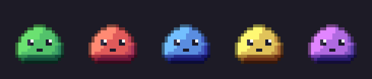

*One recipe: Pad, a Palette Swap with four two-row palettes and `keep_original` on, then Shade and a
selective Outline, which run on every variant.*

Bake palette swaps for variants that never change at runtime (shiny forms, enemy tiers, team
colors): they cost nothing in the game, leave the sprite's material free, and work on any node.
Keep a palette swap shader for colors chosen or animated at runtime (character
customization, palette cycling).

### Scalers

| Algorithm | Look |
|---|---|
| **Nearest** | Every pixel becomes a crisp block of `factor`×`factor`. |
| **Scale2x / Scale3x** | EPX / AdvMAME: rounds off diagonal staircases, the smoothed look of emulators and of some DS-era sprite upscales. |
| **Scale4x** | Scale2x twice. |
| **MMPX** | 2×, style-preserving (McGuire and Gagiu, 2021): builds on Scale2x with rules for lines, slopes and single-pixel details, so results look closer to hand-drawn. |
| **MMPX 4x** | MMPX twice. |

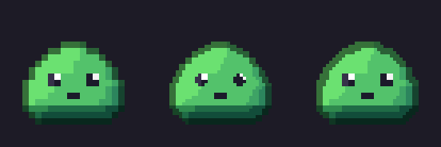

*The outlined slime at 2× with Nearest, Scale2x and MMPX. Scale2x rounds every staircase,
including the eyes; MMPX keeps single-pixel details like the eye glints.*

None of them add colors, so the result stays in your palette. A normal map layer is scaled
nearest alongside the colors.

### Rotation

[BitKilnRotate](docs/classes/BitKilnRotate.md) rotates with RotSprite: each frame is scaled to 8×
with Scale2x (three times), then sampled at the rotated positions. Lines stay clean and no new
colors appear, where ordinary rotation smears or breaks pixel art. Angles are clockwise; exact
quarter turns use the original pixels.

Set **Directions** to make a set facing evenly around the circle from **Angle**: 8 for top-down
characters, 16 for vehicles. With the **Variants** layout each direction bakes to its own file
(`ship_baked_r045.png`); with **Rows** they stack as rows of one sheet, ready for a Sprite Frames
output with one animation per row. **Expand** grows frames to fit the rotated corners, the same
size for every angle. Normal maps rotate with the colors.

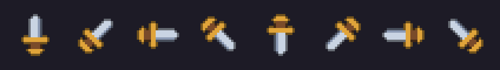

*A 16×16 sword with **Directions** 8 and a selective Outline after the rotation, so every direction
gets a clean 1 px edge.*

### Normal maps

[BitKilnNormalMap](docs/classes/BitKilnNormalMap.md) builds a height map, then turns its slopes into normals:

- **Bevel**: the height rises from the sprite's edge toward its middle over `bevel_radius` pixels,
  as if inflated. `bevel_profile` reshapes it (empty = rounded).
- **Detail**: bright colors stand out by `detail_depth` pixels (dark ones with `invert_detail`).
- **Snapping**: `snap_directions` (8 by default) and `snap_steepness` limit the normals to a few
  directions and steepnesses. Lights then fall on the sprite in clean bands, the way a pixel artist
  shades, instead of smooth gradients. 0 directions turns it off.

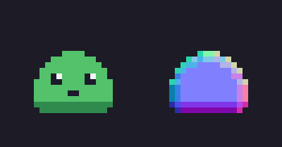

Normals follow Godot's convention (green = up); `flip_green` gives DirectX's. Switch the dock's
layer menu to **Lit** to see the sprite shaded by a light that follows the mouse.

### Shading

[BitKilnShade](docs/classes/BitKilnShade.md) shades flat colors the way pixel artists do: a few
lighter bands on the side facing **Light Direction** and darker ones away from it, spread over the
light the sprite actually gets so every band shows. Hues shift toward yellow in the light and
toward blue in the shadow (**Hue Shift**, **Saturation Shift**), instead of only getting lighter
or darker. With a **Palette**, every shade snaps to its nearest color.

The shape comes from a [BitKilnNormalMap](docs/classes/BitKilnNormalMap.md) before it (whose
snapping decides how the bands fall), or from a smooth rounded one made just for shading. The
**Rim Light** group adds a thin edge of light on the edges facing **Rim Direction**.

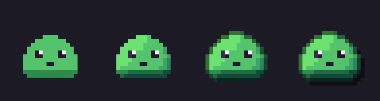

*Left to right: the flat source (with a Pad for room), then BitKilnShade with its defaults, then a
selective BitKilnOutline, then a BitKilnShadow.*

### Glow and blur

[BitKilnGlow](docs/classes/BitKilnGlow.md) draws a halo that fades over **Radius** pixels in a few
crisp **Rings**, around the whole sprite or only its bright pixels (eyes, gems, flames). It can use
one color or the glowing pixels' own colors, stay behind the sprite or add light over it.

[BitKilnBlur](docs/classes/BitKilnBlur.md) blurs with a box, a gaussian or a motion smear, then
snaps the soft edges to **Alpha Steps** levels of transparency. Both can dither between levels
with an ordered pattern. Follow either with a Quantize to bring the colors into your palette.

### Sprite sheets

- **Frames**: set the grid, or click **Guess Frame Grid** (see [Frames](#frames)).
- [BitKilnRepack](docs/classes/BitKilnRepack.md) rearranges frames into a new number of
  **Columns** (0 = one row), keeps a range (**First**, **Count**) and can **Skip Empty** frames:
  a 4×4 sheet into a strip, a strip into rows of 8, frames 5–8 as their own animation.
- A **Sprite Frames** output writes a `SpriteFrames` resource cut from the Color output. With
  **Per Row**, each row of frames becomes an animation, named by **Animation Names** (or
  `row_0`, `row_1`…). Rebaking rebuilds the same file, so scenes using it keep working.

### Overlays

[BitKilnOverlay](docs/classes/BitKilnOverlay.md) draws a **Texture** on every frame: accessories
and stickers, damage and dirt, a cloth or scale pattern, shading painted by hand, a background.
It never scales the texture smoothly, so its pixels stay crisp.

- **Placement**: **Place** puts it once per frame at **Align** (0–1 across the frame: (0.5, 1) is
  bottom middle) plus **Offset** pixels. **Tile** repeats it across the frame, for patterns.
  **Stretch** scales it to the frame, nearest neighbour.
- **Blend**: **Normal** covers the image; turn on **Clip To Sprite** to draw only over the
  sprite's own pixels. **Behind** goes under the sprite. **Multiply**, **Screen**, **Overlay** and
  **Add** darken, lighten or texture the sprite's pixels and never draw outside them.
- **Opacity** below 1 draws whole pixels in an ordered pattern (**Dither**), so no new colors
  appear; turn Dither off to mix colors instead.
- **Texture Frames** cuts the texture into a grid: frame 1 of the image gets the texture's frame
  1, frame 2 its frame 2, and so on, starting over when the texture runs out. A hat drawn as a
  matching strip follows a walk cycle this way. **Frame** limits the overlay to one frame.
- **Layer** draws on the normal map instead, to add surface detail by hand after a Normal Map op.

Like other ops, it takes a [mask](#masks), and the recipe bakes again when the texture changes.

### Baking a material

[BitKilnMaterial](docs/classes/BitKilnMaterial.md) renders the image through a CanvasItem material
and keeps the result: tune an effect live with a shader (a hit flash, a palette shader,
your own), then freeze it into the PNG so the game doesn't run the shader. **Parameters** overrides
shader parameters for this bake only (`{"flash_amount": 1.0}`), and a `sheet_frames` uniform
(`vec2`: columns and rows), if the shader has one, is set to the frame grid. The material itself is never changed.

It needs a renderer, so it works in the editor and in games but skips itself (with a warning) in
`--headless` runs. Effects that change over time are caught at an arbitrary moment, and effects
that draw outside the sprite need a Pad before it.

## Animation

[BitKilnAnimate](docs/classes/BitKilnAnimate.md) turns a still sprite into an animated sheet, the
way tools like Juice FX do, but inside the recipe: outlines, palettes and scalers can come before
or after it. Each source frame becomes a row of frames (see [Frame counts and speed](#frame-counts-and-speed)),
so a sheet of poses gets an animation per pose; after Particles or an FX sheet, it runs across
their animation instead. **Effects** is a stack of [BitKilnMotion](docs/classes/BitKilnMotion.md)s,
applied in order:

| Effect | What it does |
|---|---|
| **Squash** | Squash and stretch around **Pivot** (bottom middle by default), **Cycles** times. |
| **Jump** | Hops up **Amount** pixels and lands. |
| **Shake** | Jitters along **Direction**'s axes, settling down. |
| **Wobble** / **Skew** | Rocks or leans like jelly, settling down. |
| **Spin** | Full turns around **Pivot**. |
| **Wave** | Rows (or columns) ripple sideways. |
| **Move** / **Scale** | Slides along **Direction**, or grows. |
| **Flash** / **Tint** | Turns or mixes in **Color**: hit flashes, poison tints. |
| **Fade** / **Blink** | Fades out, or disappears and reappears. |
| **Dissolve** | Crumbles away pixel by pixel, with a glowing edge in **Color**. |
| **Afterimage** | Ghost copies of earlier frames trail behind. |

Every effect has a window (**Start**, **End**, 0–1 of the animation) and an optional **Curve**: for
swinging effects it scales the swings, for the others it's the value itself. The Inspector only
shows the settings an effect uses. **Loop** makes the last frame lead back into the first; turn it
off for one-shots like a death dissolve. **Margin** gives the motion room.

It stays pixel art: movement snaps to whole pixels, rotation and skewing use RotSprite (no new
colors), and fades remove whole pixels in an ordered pattern (**Dither Fades**). Normal maps
animate with the colors.

**Animation Presets**, a menu on the op in the Inspector, loads a ready-made setup in one undoable
step: Hit Flash, Damage Blink, Idle Bob, Breathe, Jump, Collect, Pulse, Wobble, Jelly, Spin, Shake,
Teleport and Death Dissolve. Presets set the **Duration** and leave **Fps** as you have it. Add a
Sprite Frames output to play the result in the game, or a GIF output to share it.

| Jump | Jelly | Hit Flash | Death Dissolve |
|---|---|---|---|
| 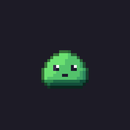 |  |  |  |

*Presets on the shaded, outlined slime, at 12 fps.*

## Frame counts and speed

You don't pick frame counts for animated effects; you pick how long they last and how fast they
play. [BitKilnAnimate](docs/classes/BitKilnAnimate.md), [BitKilnParticles](docs/classes/BitKilnParticles.md)
and [BitKilnFxSheet](docs/classes/BitKilnFxSheet.md) each have a **Timing** group:

- **Duration**: how long the effect lasts, in seconds.
- **Fps**: the speed it plays at. Pixel art usually plays at 8–12 fps; fast effects like sparks
  look smoother at 12–15.
- **Frame Count**: 0 (Auto) makes Duration × Fps frames. The Inspector shows the result under it
  ("Auto: 12 frames = 1.00 s at 12 fps"). Type a number to fix the count instead; the duration
  then follows from it.

Auto in Animate also nudges the count, by up to a quarter, so that effects repeating over the
whole animation (squashes, hops, wobbles, blinks) get the same number of frames every cycle: three
blinks in 0.8 s at 10 fps make 6 frames instead of 8.

Particles and FX sheets make their own frames when they start from a single frame (a blank canvas,
or a sprite), so leave the recipe's **Frames** at 1×1. Over a source sheet that already has several
frames, they draw on those frames instead.

**Stacking animated ops.** The first op that animates the image sets its frames and speed; animated
ops after it work on that animation instead of making their own:

- Particles or an FX sheet after an Animate draw on its frames, at its speed.
- An Animate after Particles or an FX sheet runs its effects across their frames (a flash over a
  burst, a squash over a magic loop), at their speed. With **Frame Count** set, it resamples the
  animation to that many frames.

The Inspector note under Frame Count says when an op follows the animation before it. Animate's
**Source Frames** decides how it reads the frames coming in: **Auto** (an animation when an earlier
op made one, poses otherwise), **Poses** (each frame gets its own animation, for a sheet of
poses) or **Animation** (for a source sheet that's already an animation, like a walk cycle,
played at the op's **Fps**).

Sprite Frames and GIF outputs play at the same speed: their **Fps** is 0 by default, which means
the fps of the last animating op they use (10 without one). Set it to play an output at another
speed. The BitKiln dock's play bar follows it too, and shows how long the frames last.

Typical lengths:

| Effect | Duration | Frames at 10 fps |
|---|---|---|
| Hit flash, small pop | 0.3–0.5 s | 3–5 |
| Jump, collect, squash | 0.6–0.9 s | 6–9 |
| Death, dissolve | 0.8–1.2 s | 8–12 |
| Looping fire, smoke, sparkles | 1–2 s | 10–20 |

For particles, keep the fastest particle under about 3 pixels per frame (top **Speed** ÷ Fps), or
it looks like it teleports; raise Fps for fast effects.

## Particles

[BitKilnParticles](docs/classes/BitKilnParticles.md) simulates particles and draws them across the
frames, like Pixel FX Designer, as part of a recipe. Use it on a blank canvas
("New BitKiln Canvas"), or over a sprite (a torch's flame, a potion's bubbles). It makes
Duration × Fps frames, each showing the particles at its moment (see
[Frame counts and speed](#frame-counts-and-speed)).

| Group | Settings |
|---|---|
| **Timing** | **Duration**, **Fps**, **Frame Count** (0 = Auto), **Loop**, **Substeps** (smoother fast particles), **Seed**. |
| **Emission** | **Rate** per second, **Bursts** (when, how many), **Emitter** (point, circle, ring, rectangle, line), its size and offset. |
| **Motion** | **Lifetime** and its variation, **Direction** and **Spread**, **Speed** range, **Gravity**, **Drag**, **Radial Accel** (push or pull), **Swirl**. |
| **Look** | **Shape** (pixel, circle, square, diamond, star, streak trailing the movement, or a **Sprite** sheet played over each particle's life), size from **Size Start** to **Size End** along a **Size Curve**, **Colors** over life (a Gradient; its alpha fades), **Color Steps**, **Blend** (normal or additive), **Dither Fades**, **Palette**. |

The same settings always give the same sheet. With **Loop**, emission repeats exactly every
Duration and the simulation is warmed up first, so the last frame flows into the first, with no
pop when the animation wraps. Without it, the effect starts empty: good for bursts. Particles snap to whole
pixels, colors change in **Color Steps** bands over their life, and fades drop pixels in an
ordered pattern, so a sheet stays in a handful of colors.

**Particle Presets**, a menu on the op in the Inspector, loads Fire, Smoke, Sparks, Explosion,
Magic, Dust, Rain, Snow, Confetti or Bubbles (tuned for 32×32 frames) in one undoable step.

| Fire | Magic | Explosion | Snow |
|---|---|---|---|
|  | 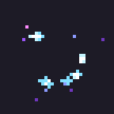 |  | 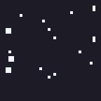 |

*Presets on a blank 32×32 canvas, unchanged.*

## Generators

Generators are ops that draw. On a recipe without a source ("New BitKiln Canvas" on a folder),
they make art from a blank canvas of `canvas_size` per frame; on a recipe with a source, they draw
over it. Like every op, they work frame by frame, so a frame grid gives animations or sets, and
every other op (outlines, shading, palettes, scalers) can follow them.

### Shapes

[BitKilnShape](docs/classes/BitKilnShape.md) draws an ellipse or circle, rectangle, regular
polygon, star or line, filled and/or outlined, placed around the frame's center with an
**Offset**. A pixel is inside when its center is, which gives the symmetric, hand-drawn-looking
circles of pixel art. Stack several for icons, particles and UI pieces. In the **Animation** group,
**Grow**, **Move** and **Spin** change the shape a little on each frame, and **Frame** limits it
to one frame.

### FX sheets

[BitKilnFxSheet](docs/classes/BitKilnFxSheet.md) draws an animated effect across the frames:
**Sparkle** (looping twinkles), **Impact** (a flash, then spikes bursting out), **Smoke** (puffs
drifting toward **Direction**), **Slash** (a sweeping crescent), **Orb** (a looping pulse with a
halo) and **Ring** (a shockwave). Its **Timing** group sets how long it lasts and how many frames
it makes (see [Frame counts and speed](#frame-counts-and-speed)); add a Sprite Frames output to
play it.

Each pixel gets a heat from the hot core to the fading edge, colored by **Colors** (a Gradient) in
**Color Steps** hard bands, so a sheet uses only a few colors. With a Constant gradient whose
points sit at 0, 1/n, 2/n… for n steps, every band is exactly one of its colors. **Count**,
**Scale**, **Seed** and a **Timing** curve shape the effect.

| Impact | Slash | Sparkle | Ring |
|---|---|---|---|
|  | 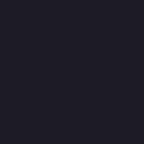 |  | 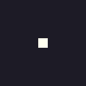 |

*Each effect with its default settings on a blank 32×32 canvas.*

### Random sprites

[BitKilnRandomSprite](docs/classes/BitKilnRandomSprite.md) makes a different random sprite in every
frame: **Creature** (round bodies with limbs, and eyes), **Ship** or **Item**. Each is a random half
following a density map, mirrored (**Horizontal**, **Vertical** or **Both**), kept in one piece,
shaded from top to bottom and outlined. Colors come from ramps of a **Palette**, or from a random
hue per sprite. Frame n uses seed + n, so an 8×8 grid gives 64 sprites, and the same seed always
gives the same set: keep the ones you like, or bake a fresh set for procedural enemies and loot.

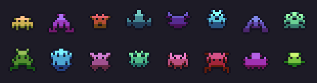

*Creature, seed 7, on an 8×2 frame grid of 16×16 frames.*

### Noise and ramps

[BitKilnNoise](docs/classes/BitKilnNoise.md) fills every frame with noise from a `FastNoiseLite`
(seamless by default, so frames tile), banded through a Gradient: grass, dirt, water and stone
textures, clouds (with a gradient that turns transparent), terrain maps. Each frame samples its
own part of the noise, for variations.

[BitKilnRamp](docs/classes/BitKilnRamp.md) draws a color ramp per base color, one per row: darker
shades shifting toward blue and lighter ones toward yellow, the way pixel artists build ramps by
hand. With a Palette output, it designs palettes for Shade, Quantize and Random Sprite.

## Autotiles

[BitKilnAutotile](docs/classes/BitKilnAutotile.md) turns five hand-drawn tiles into the full
47-tile "blob" set, so a terrain paints with every edge and corner right. The source is five tiles
in a row (frames 5×1), each drawn in one style all around:

| Tile | Draw it as |
|---|---|
| 1. **Island** | A tile with nothing around it: outer corners on all four sides. |
| 2. **Column** | Connected above and below: its left and right edges show. |
| 3. **Row** | Connected left and right: its top and bottom edges show. |
| 4. **Cross** | Connected on all four sides but not diagonally: inner corners. |
| 5. **Fill** | The middle of the terrain. |

Every output tile is put together from quarters of these (so tiles need an even size) and laid
out in **Columns** (8 by default). Add a **Tile Set** output: it writes a `TileSet` with a
Match Corners and Sides terrain (named and colored in the output), every tile's peering bits set,
ready for the TileMap terrain tools. Rebaking rebuilds the same file, so TileMaps using it keep
working. Keep the frame size after Autotile (no Pad or Extrude) when using the Tile Set output.

## Editor tools

The **BitKiln** dock (bottom panel):

| Area | What it does |
|---|---|
| **Recipe list** | Every recipe in the project, with its status: up to date, changed since the last bake, or failed. Filter by name; double-click to inspect. **Bake All Stale** bakes every recipe that isn't up to date. |
| **Play bar** | Under the preview, for sheets: show one frame at a time, play and pause, step, scrub, and set the speed (taken from the recipe's Sprite Frames output when it has one). |
| **Preview** | The selected recipe's result, at whole-number zoom on a checkerboard of whole sprite pixels. Menus pick the source, the variant, the layer (**Color**, **Normal**, **Lit**), the view (**Result**, **Source**, **Side by Side**) and how many ops to apply ("Up to 2: Outline", or "As Output 2"), to see the stack step by step. The wheel or a pinch zooms at the cursor; drag, two-finger scroll or Shift+wheel pans; the grid button shows frame edges. Size, frame size, color count, warnings and time per run appear underneath. |
| **Side panel** | **Bake**; **Outputs**, which lists the recipe's files to open them (or their folder in your file manager); the recipe's status, import checks and the bake log. |

Inspecting a recipe shows it in the dock. Recipes are edited in the Inspector; the preview follows
every edit (including ones inside ops, gradients and curves), undo and redo.

FileSystem dock: right-click images → **New BitKiln Recipe** (one per image) or **New Shared
BitKiln Recipe** (one for all of them); a folder → **New BitKiln Canvas** (a recipe without a
source, for generators); recipes → **Bake**.

### Baking and auto bake

Baking writes the outputs, imports them and builds Canvas Texture, Sprite Frames and Tile Set
outputs. Recipes with
`auto_bake` bake again when their source or a texture an op uses (a palette) is reimported, which
happens whenever you save the file in another program. Chains of recipes bake in turn; each recipe
bakes at most once per change, so a loop can't run forever.

BitKiln remembers what each recipe was last baked from, in the project's editor settings folder
(`.godot/editor`), and marks recipes whose source, ops or outputs changed since.

To bake without opening the editor, for example in a build script:

```bash
godot --headless --import    # on a fresh checkout: imports assets and registers BitKiln's classes
godot --headless --script res://addons/bitkiln/tools/bake_all.gd
```

It exits with code 1 if a recipe fails. Canvas Texture, Sprite Frames and Tile Set outputs need the
editor to import their PNGs first, and Bake Material needs a renderer, so this script skips them.

### Import checks

The side panel warns about settings that spoil pixel art, with a **Fix** button for each:

- the project's default texture filter isn't **Nearest** (blurry when scaled);
- the source or an output is compressed lossily or for the GPU (colors shift);
- the source or an output has mipmaps (blurry when drawn smaller).

## Using recipes from code

[BitKilnBaker.run()](docs/classes/BitKilnBaker.md#method-run) only computes, so recipes work at
runtime too, for example to recolor a sprite when the player picks a palette. It returns one
[BitKilnContext](docs/classes/BitKilnContext.md) per variant:

```gdscript
var recipe := preload("res://characters/hero_kiln.tres")
var contexts := BitKilnBaker.run(recipe)
$Sprite2D.texture = contexts[0].color.to_texture()
```

An exported game only has the imported texture, not the source PNG, so BitKiln reads the
texture's image instead; import the source **Lossless** for exact colors.
[BitKilnBaker.bake()](docs/classes/BitKilnBaker.md#method-bake) writes files, which only makes
sense in the editor or a headless script.

### Writing your own op

Extend [BitKilnOp](docs/classes/BitKilnOp.md) and override `_apply()`. Pixels live in
[BitKilnBuffer](docs/classes/BitKilnBuffer.md)s as packed ints; copy `pixels` to a local
variable, change it, and assign it back:

```gdscript
@tool
class_name InvertOp
extends BitKilnOp
## Inverts every color, keeping alpha.

func _apply(context: BitKilnContext) -> void:
	var p := context.color.pixels
	for i in p.size():
		var c := p[i]
		if c != 0:
			p[i] = BitKilnBuffer.pack(255 - BitKilnBuffer.red(c), 255 - BitKilnBuffer.green(c),
				255 - BitKilnBuffer.blue(c), BitKilnBuffer.alpha(c))
	context.color.pixels = p
```

Use `context.frame_size` to keep neighbour lookups inside a frame, `context.remap_frames()` or
`context.scale_nearest()` to change the size of every layer at once, and `context.warn()` for
messages that show in the dock. An op that makes variants overrides `_process()` instead and
returns a context per variant (see [BitKilnPaletteSwap](docs/classes/BitKilnPaletteSwap.md)).

## Class reference

| Class | Role |
|---|---|
| [BitKilnRecipe](docs/classes/BitKilnRecipe.md) | Source, ops and outputs. |
| [BitKilnOutput](docs/classes/BitKilnOutput.md) | A file a recipe writes. |
| [BitKilnOp](docs/classes/BitKilnOp.md) | Base class of ops. |
| [BitKilnPad](docs/classes/BitKilnPad.md), [BitKilnTrim](docs/classes/BitKilnTrim.md), [BitKilnExtrude](docs/classes/BitKilnExtrude.md), [BitKilnTransform](docs/classes/BitKilnTransform.md), [BitKilnRotate](docs/classes/BitKilnRotate.md), [BitKilnScale](docs/classes/BitKilnScale.md), [BitKilnRepack](docs/classes/BitKilnRepack.md) | Shape ops. |
| [BitKilnOutline](docs/classes/BitKilnOutline.md), [BitKilnShadow](docs/classes/BitKilnShadow.md), [BitKilnGlow](docs/classes/BitKilnGlow.md), [BitKilnBlur](docs/classes/BitKilnBlur.md), [BitKilnNormalMap](docs/classes/BitKilnNormalMap.md), [BitKilnShade](docs/classes/BitKilnShade.md) | Edge and light ops. |
| [BitKilnPaletteSwap](docs/classes/BitKilnPaletteSwap.md), [BitKilnQuantize](docs/classes/BitKilnQuantize.md), [BitKilnReduce](docs/classes/BitKilnReduce.md), [BitKilnAdjust](docs/classes/BitKilnAdjust.md), [BitKilnGradientMap](docs/classes/BitKilnGradientMap.md), [BitKilnOverlay](docs/classes/BitKilnOverlay.md), [BitKilnMaterial](docs/classes/BitKilnMaterial.md) | Color ops. |
| [BitKilnAnimate](docs/classes/BitKilnAnimate.md), [BitKilnMotion](docs/classes/BitKilnMotion.md) | Animation. |
| [BitKilnParticles](docs/classes/BitKilnParticles.md) | Particles. |
| [BitKilnShape](docs/classes/BitKilnShape.md), [BitKilnFxSheet](docs/classes/BitKilnFxSheet.md), [BitKilnRandomSprite](docs/classes/BitKilnRandomSprite.md), [BitKilnNoise](docs/classes/BitKilnNoise.md), [BitKilnRamp](docs/classes/BitKilnRamp.md) | Generators. |
| [BitKilnAutotile](docs/classes/BitKilnAutotile.md) | The autotile expander. |
| [BitKilnBaker](docs/classes/BitKilnBaker.md), [BitKilnBaker.Result](docs/classes/BitKilnBaker.Result.md) | Runs recipes and writes their outputs. |
| [BitKilnContext](docs/classes/BitKilnContext.md) | The layers and frame grid ops work on. |
| [BitKilnBuffer](docs/classes/BitKilnBuffer.md) | RGBA8 pixels as packed ints. |
| [BitKilnPalette](docs/classes/BitKilnPalette.md) | Reads palettes from textures; color distance. |
| [BitKilnFilter](docs/classes/BitKilnFilter.md) | Soft operations for ops: blurs, alpha steps, distances. |
| [BitKilnSheet](docs/classes/BitKilnSheet.md) | Sprite sheet helpers: frame grid guessing, sprite bounds. |
| [BitKilnRaster](docs/classes/BitKilnRaster.md) | Pixel-perfect shape masks for generators. |
| [BitKilnGif](docs/classes/BitKilnGif.md) | Animated GIF encoding. |

## Troubleshooting

| Problem | Fix |
|---|---|
| Baked sprites look blurry in the game | The project's default texture filter isn't **Nearest**. The dock's side panel warns about it, with a **Fix** button. |
| Colors in the game are slightly off | The PNG is imported with lossy or VRAM compression. Use the side panel's **Fix**, or set the file's import to **Lossless**. |
| Outlines, shadows or glows are cut off | They have nowhere to go: put a [BitKilnPad](docs/classes/BitKilnPad.md) before them. On sheets, ops stop at frame edges on purpose. |
| A recipe didn't bake again after I changed the source | `auto_bake` is off, or Godot hasn't reimported the file yet (it does when the editor window regains focus). Click **Bake** to force it. |
| "the color PNG isn't imported yet; bake again" | A Sprite Frames, Canvas Texture or Tile Set output needs its PNG imported first. Bake once more. |
| Every recipe shows as changed after cloning the project | Bake records live in `.godot/editor`, which isn't committed. **Bake All Stale** once, or run `tools/bake_all.gd` in CI. |
| Bake Material does nothing in a build script | It needs a renderer, so `--headless` runs skip it with a warning. Bake it in the editor. |
| The preview is slow | Large sheets with 4× scalers or RotSprite take a while. Turn those ops off with their **Enabled** switch while tuning the others. |

## Limitations

- **Speed.** Ops run in GDScript on the CPU. Sprites and sheets of a few hundred pixels preview
  instantly; very large sheets with 4× scalers or RotSprite (which works at 8×) take noticeably
  longer. Turn ops off while tuning the others.
- **Whole-number scaling only**, and the scalers are 2×-based (plus Scale3x).
- **Masks** only work on ops that keep the image's size, and after Transform, Rotate or Repack
  they're stretched over the new frame instead of following the art exactly.
- **Bake Material** needs a renderer, and has only been tested with the Compatibility (OpenGL)
  renderer so far.
- **Members starting with `_`** are internal and may change between versions.

## License

BitKiln is released under the [MIT License](LICENSE). The MMPX scaler is a port of MIT-licensed code; see
[THIRD_PARTY_NOTICES.md](THIRD_PARTY_NOTICES.md).
